# my-favorites 流程图与状态流转图（Mermaid 源文件）

> 配套：`docs/原型/index.html`（原型总览）。浏览器渲染版见同目录 `流程与状态图.html`。
> 依据：功能文档 v0.3.1（D1–D21）+ 技术方案 v0.2（§5–§9）。图与决策记录一一对应，评审改动后需回写本文档。

---

## 目录

1. [产品全景与三形态架构](#1-产品全景与三形态架构)
2. [四钩子留存闭环](#2-四钩子留存闭环)
3. [收藏即时归位（<50ms 缓存路径）](#3-收藏即时归位50ms-缓存路径)
4. [收纳盒自动归位流水线（D20 镜像模式）](#4-收纳盒自动归位流水线d20-镜像模式)
5. [收纳盒条目状态机](#5-收纳盒条目状态机)
6. [两阶段整理（导入 → Aha）](#6-两阶段整理导入--aha)
7. [整理会话与版本状态机](#7-整理会话与版本状态机)
8. [整理应用 → 通知 → 回滚（时序与乐观锁 · D27）](#8-整理应用--通知--回滚时序与乐观锁--d23)
9. [一键快照生成与降级链](#9-一键快照生成与降级链)
10. [死链分层探测与三级判定](#10-死链分层探测与三级判定)
11. [书签状态流转](#11-书签状态流转)
12. [导入双通道（去重/幂等/隐私联动）](#12-导入双通道去重幂等隐私联动)
13. [自建端单容器部署架构](#13-自建端单容器部署架构)
14. [导航站生成（站点化分析投影 · D30）](#14-导航站生成站点化分析投影--d26)
15. [收藏事件与集成 Hook（出站 Webhook + 入站 API · D33 · P2）](#15-收藏事件与集成-hook出站-webhook--入站-api--d29--p2)

---

## 1. 产品全景与三形态架构

一套代码三种形态（D15：本轮只打磨「扩展 + 单用户 Docker 自建端」）。

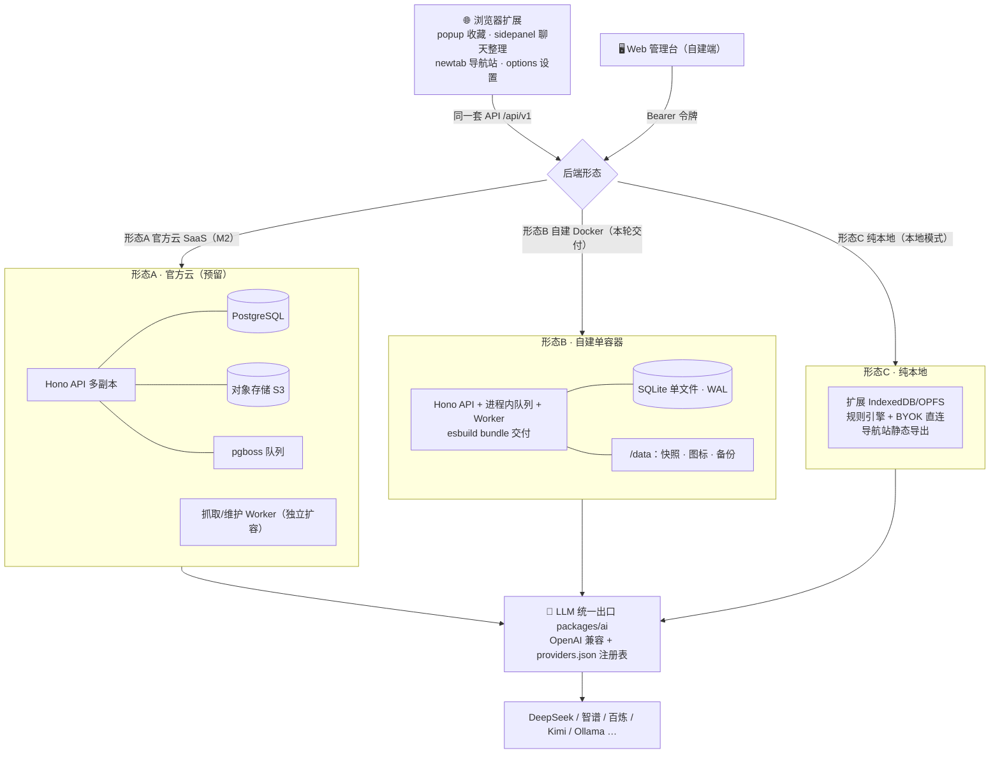

---

## 2. 四钩子留存闭环

覆盖书签全部流入路径与两类回访理由（功能文档 §4）。

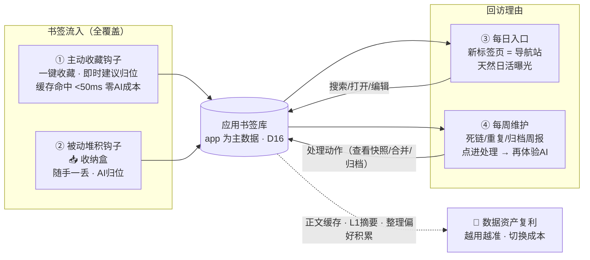

---

## 3. 收藏即时归位（<50ms 缓存路径）

技术方案 §7①。隐私校验是架构级强制步骤，不是可选（红线②）。

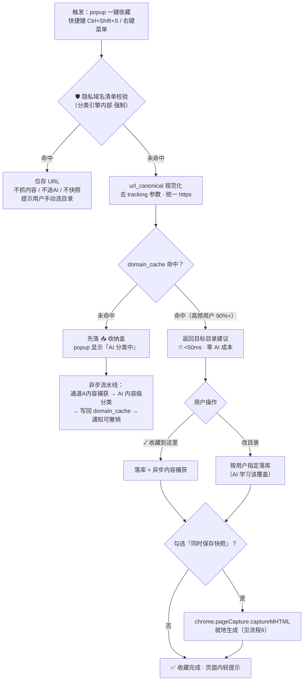

---

## 4. 收纳盒自动归位流水线（D20 镜像模式）

技术方案 §7② + D20（界面说「归位」，浏览器书签必须真的移动）。

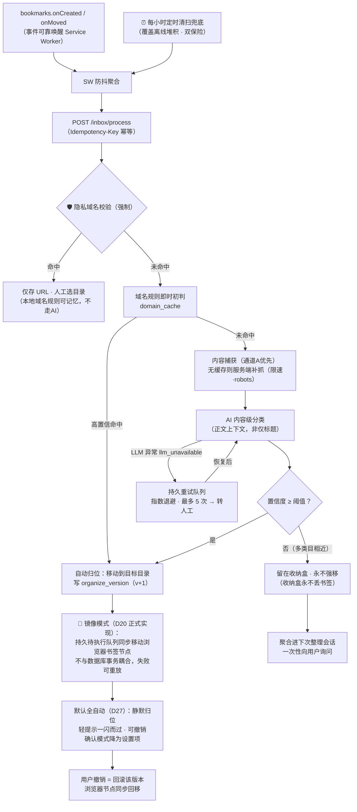

---

## 5. 收纳盒条目状态机

对应原型 06 的四种典型条目（处理中 / 已归位 / 歧义滞留 / 隐私）+ 失败重试。

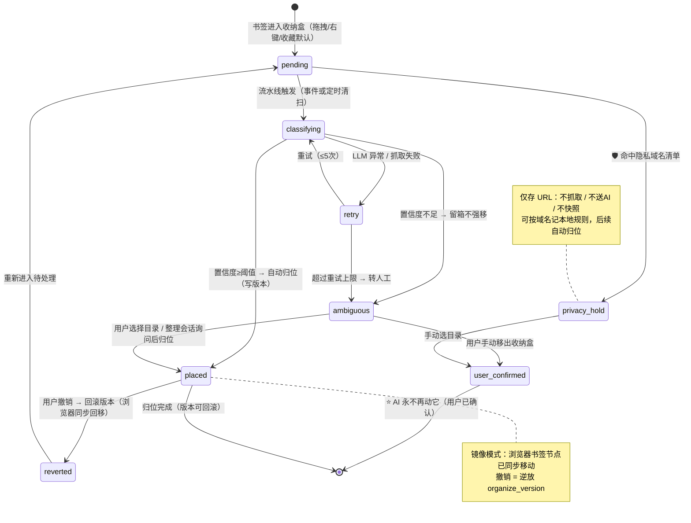

---

## 6. 两阶段整理（导入 → Aha）

阶段1 确定性规则引擎（零 LLM、零延迟）抢出 Aha；阶段2 是二次惊喜不是等待门槛（§5.2）。

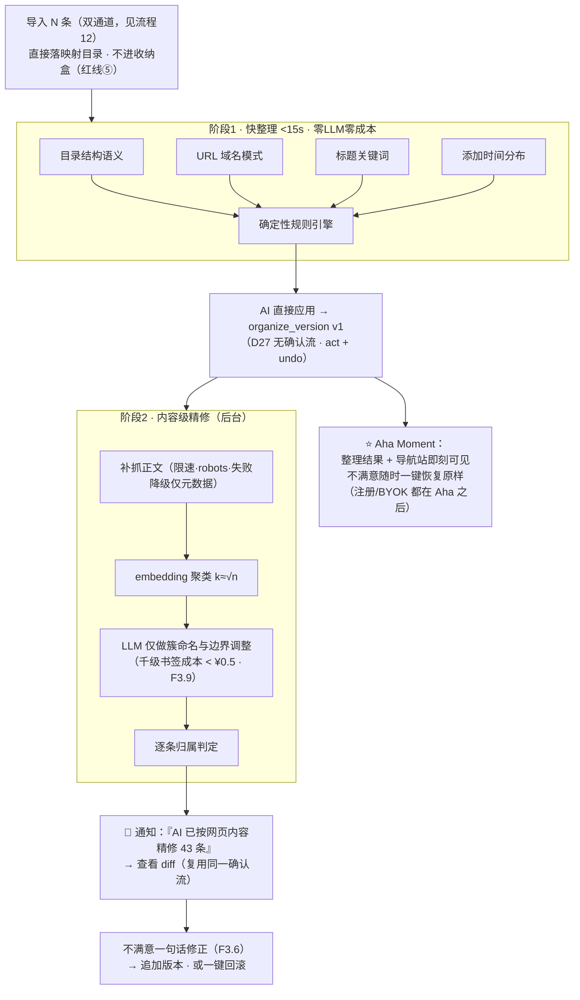

---

## 7. 整理会话与版本状态机

聊天整理与收纳盒自动归位共用同一版本体系（F3.5），不另建回滚体系。

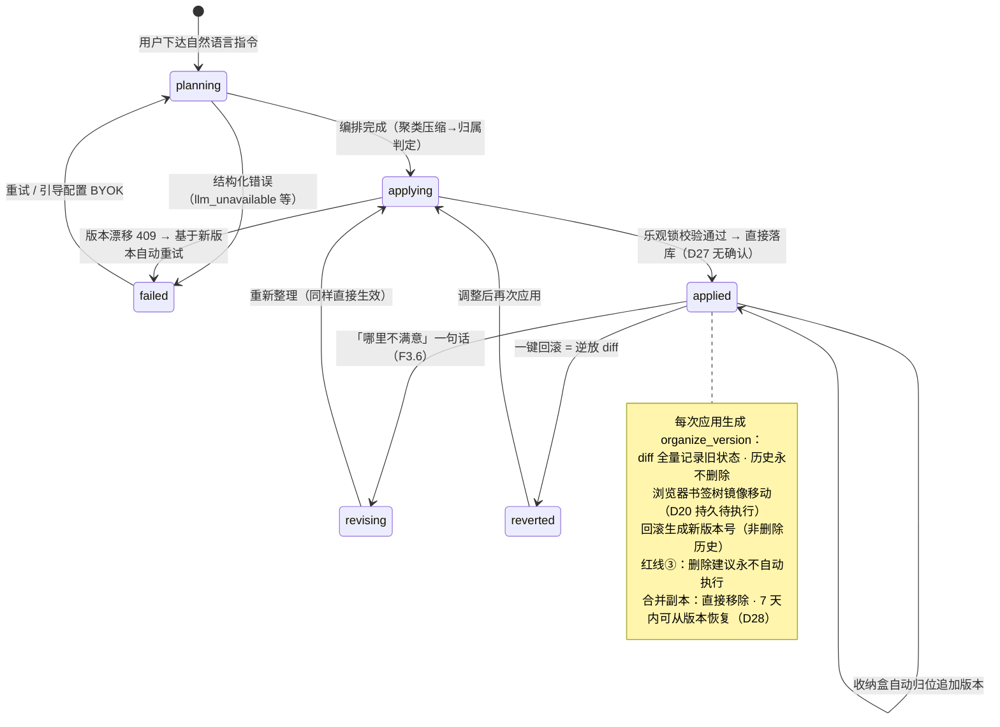

---

## 8. 整理应用 → 通知 → 回滚（时序与乐观锁 · D27）

技术方案 §7⑥（D27 修订）：乐观锁保留、确认流移除——整理直接应用，通知可撤销；镜像移动不与数据库事务共用。

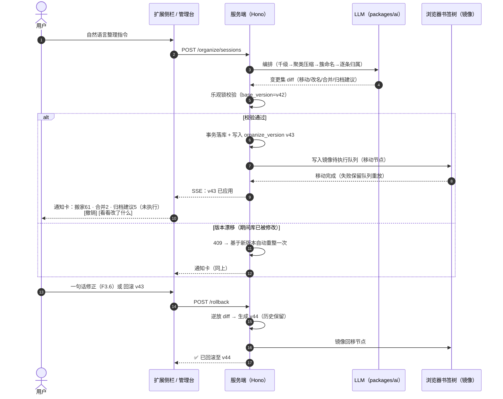

---

## 9. 一键快照生成与降级链

技术方案 §7④；隐私域名永不快照；公开导航站永不展示快照内容（红线④）。

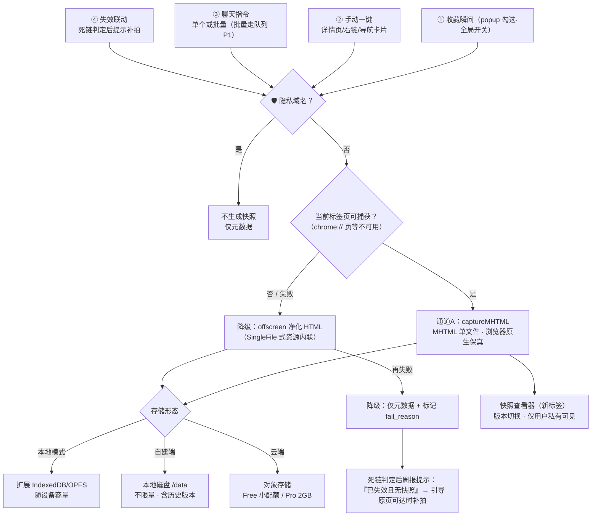

---

## 10. 死链分层探测与三级判定

技术方案 §7⑤；D3 保守判定：疑似只标注，误判不可逆所以宁可漏判。

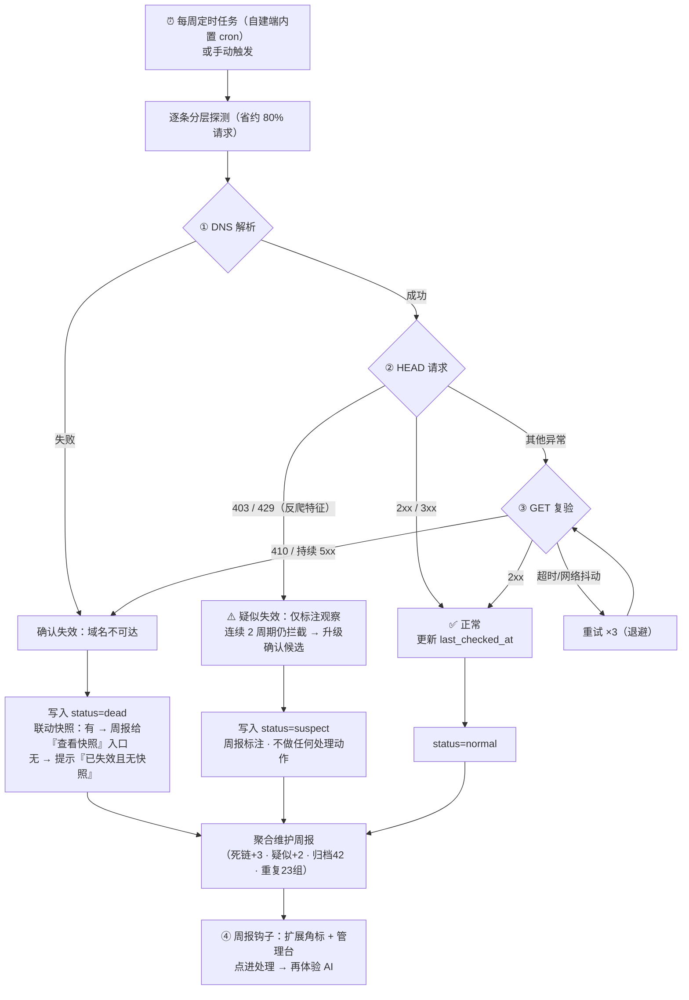

---

## 11. 书签状态流转

数据模型 `bookmark.status`（技术方案 §4）+ 快照/隐私联动。

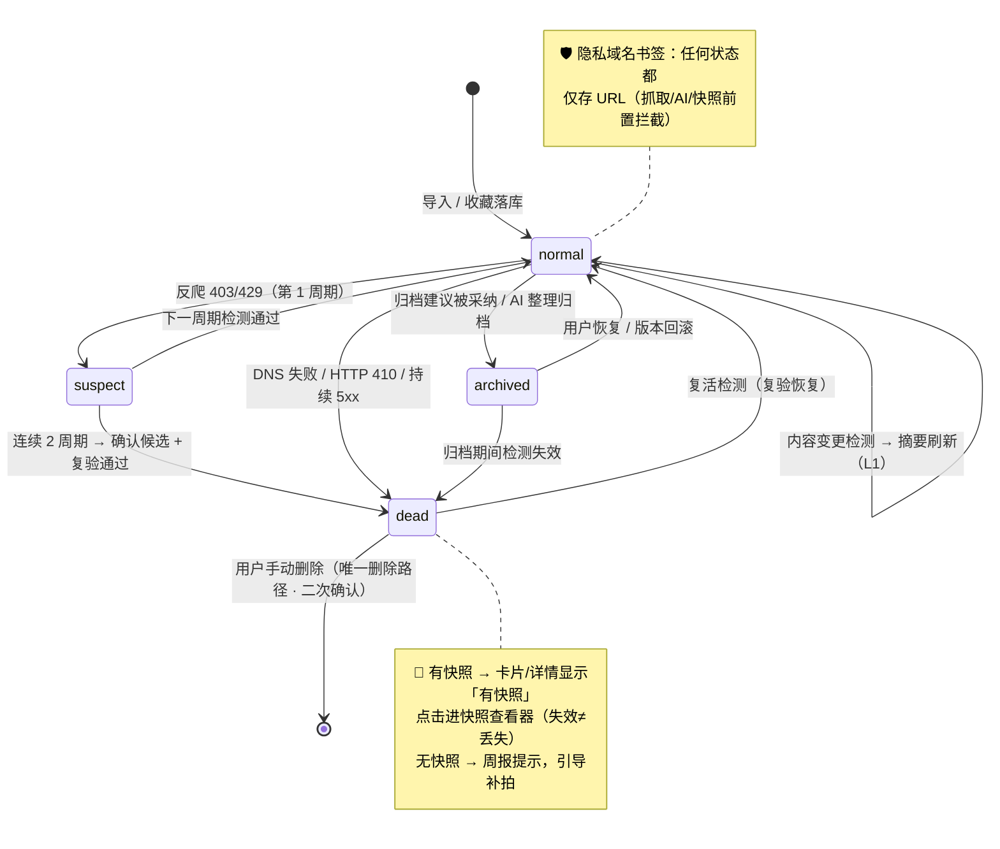

---

## 12. 导入双通道（去重/幂等/隐私联动）

技术方案 §7⑦；红线⑤：导入直接落映射目录，**不进收纳盒**。

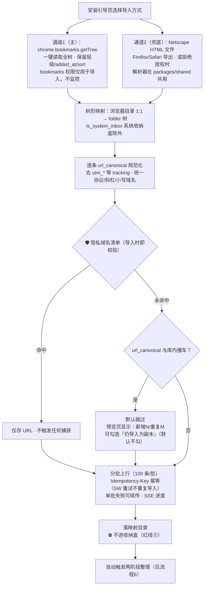

---

## 13. 自建端单容器部署架构

技术方案 §3 形态B + §8；红线①：内存 <300MB · 镜像 ≤250MB · SQLite 单文件 · ARM64。

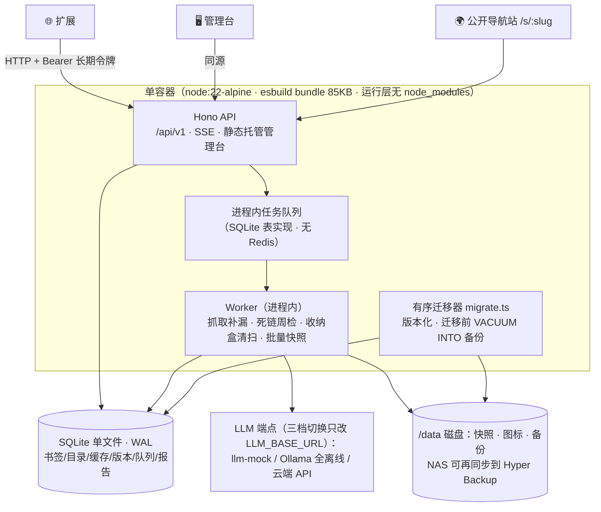

---

## 14. 导航站生成（站点化分析投影 · D30）

导航的价值在「站点入口」：文章 / 详情类书签不占导航位；资料类站点（文档 / wiki / 教程首页）同样默认不入（D31）——资料是"去读的"，不是"每天点进去的"。分析是**投影**——不改书签数据（D16 应用库是主数据），可随时重建。

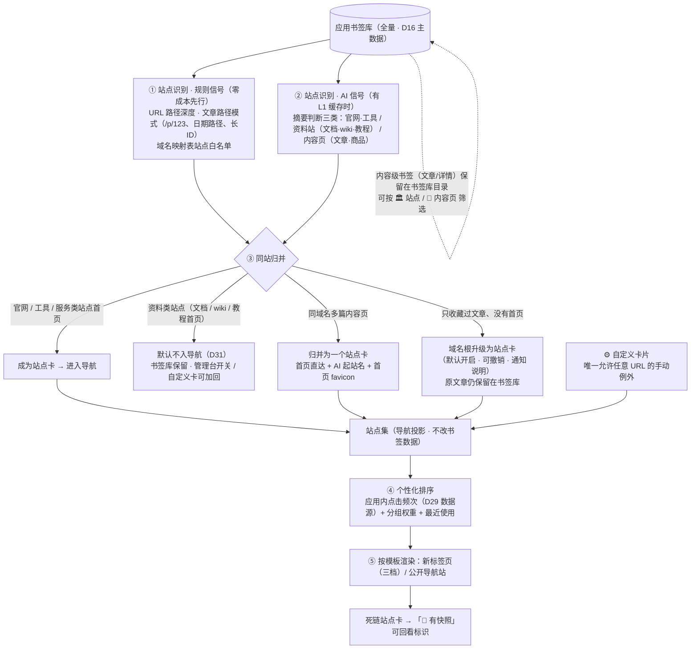

---

## 15. 收藏事件与集成 Hook（出站 Webhook + 入站 API · D33 · P2）

产品不内置高风险能力（D32：不做媒体下载），但提供中立管道——用户自备工具，我们负责把「收藏那一刻」的结构化数据可靠地送过去。定位：P3 极客 / NAS 生态口碑能力，M1/M2 不做，API 契约预留。

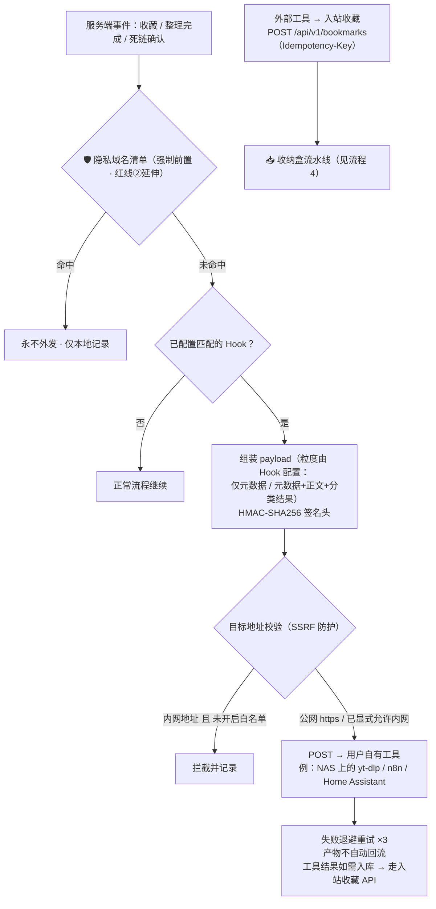

---

## 附：图 ↔ 决策/红线对照

| 图 | 关联决策/红线 |
|---|---|
| 流程3/4 | 红线②（隐私校验不可绕过）· D20（镜像模式）· F1.4/F1.5 |
| 流程6 | §5.2 两阶段 · Aha 60s · F3.9 成本策略 |
| 流程7/8 | D27（无确认流 act+undo）· F3.5/F3.6 · 乐观锁 · organize_version |
| 流程9 | D10（快照一等公民）· 红线④ · D4（云端不存 L3） |
| 流程10/11 | D3（三级保守判定）· F5.1 |
| 流程12 | 红线⑤（导入不进收纳盒）· F1.1 · 幂等 |
| 流程13 | 红线①（NAS 资源）· D12（开源免费）· D15（本轮范围） |
| 流程14 | D30（站点投影）+ D31（资料站默认不入导航）· D16（库是主数据）· D29（点击数据源）· 红线④（公开站不展示快照内容） |
| 流程15 | D33（中立管道）· D32（不做媒体下载）· 红线②（隐私前置拦截） |
